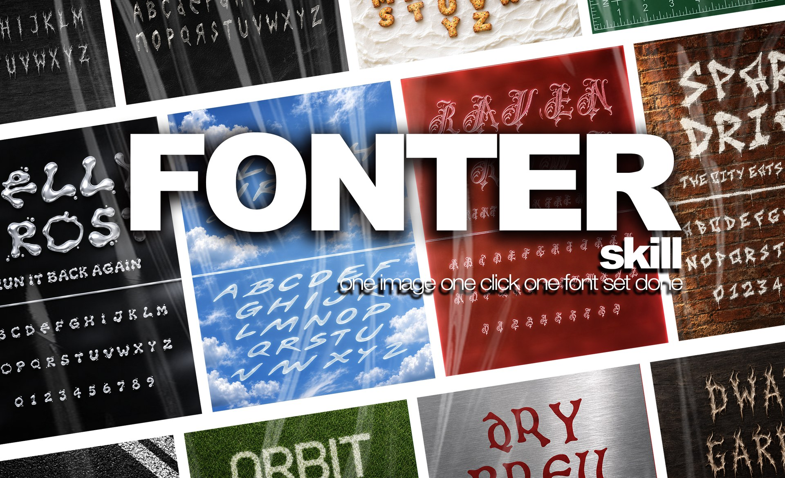

# fonter — 设计师的噩梦，还是福音？

A designer's nightmare — or a blessing? One reference image in, a real font out.

**一张参考图进去，一套能装的字体出来。** A Codex skill that turns a single reference image into a standard TTF / OTF font — upper case, lower case, digits — that keeps the reference's style and works in every Adobe app, and anywhere else you want to use it.



---

## 中文

### 它做的事

| 你给 | 它还你 |
| --- | --- |
| 一张参考图（手绘草稿 / 特殊绘制的 logo 字体 / 你暂时还不想付费的字体 —— 剽窃可耻，喜欢就买） | `.otf` + `.ttf` 标准字体文件，含大小写与数字 |
| | 一张矢量撞色风格的字体预览海报 |
| | 一张带真实材质的渲染海报（可选，不想要就不生成） |

你只需要一张参考图。参考图的平面化、拆词、切字母、矢量化、字距字高归一、封装、体检，skill 全包了 —— 第一步也不用你操心。

### 三条规矩

- **风格绝对不变。** 参考图是唯一真值，不重新设计、不"顺手优化"、不换字体气质。
- **token 尽量少。** 拆词方案与提示词都按最省的方式组织，能脚本干的绝不丢给模型。
- **交付即能装。** 出厂跑过 Adobe 体检，PS / AI / ID 里能选中、能打出字。

### 装成 Codex skill

```bash
git clone https://github.com/qianyushen/fonter ~/fontskill
ln -s ~/fontskill ~/.codex/skills/fonter
bash ~/.codex/skills/fonter/scripts/setup.sh   # 装依赖 + 自查
```

macOS 也可以直接双击 `setup.command`。依赖：Python 3.9+、`pip install -r requirements.txt`。
只有"画单词图"那一步需要模型（codex 内置 `image_gen`，或 ChatGPT 网页版），其余全部离线。

### 快速上手

```bash
python3 scripts/check_env.py                                   # 这台机器能不能直接跑
python3 scripts/segment_word.py --image 01_words/VAMPIRE/v2.png --word VAMPIRE --out 02_letters/VAMPIRE
python3 scripts/build_family.py --sources 02_letters/* --family MYFONT --out-dir 04_font --charset A-Z,0-9
python3 scripts/make_specimen.py --font 04_font/MYFONT.otf --out 05_preview/specimen.png
python3 scripts/render_material.py --project . --material "老旧红砖墙 + 街头喷漆"   # 可选：材质海报
```

海报默认把下半**排满 5 行**（26 个字 → 6 列 × 5 行，大字+数字 → 8 列 × 5 行，末行居中；`--grid-rows 2` 可回到旧版两行）。配色表共 **115 套**高饱和潘通撞色，`--palette auto` 会按字体风格散列取色并避开最近用过的 12 套，连着做几套也不会撞成同一张。

### 目录

```
SKILL.md            agent 照做的完整流程（闸门 / 词表规划 / 踩过的坑）
scripts/            切分 · 组字 · 海报 · 材质渲染 · 体检 · 环境自查
references/         生图提示词、海报与配色规范
docs/               头图 / 海报示例
setup.command       macOS 一键装依赖
```

### 已知限制

- 生图模型偶尔会画错个别字母；**字形真值以脚本渲那张海报为准**，材质图只当氛围图。
- 装饰性极强的风格（哥特花体、重笔刷）比重几何无衬线更容易返工。
- 只在 Python 3.9 以上测过。

### 许可

MIT，见 [LICENSE](LICENSE)。

---

## English

### What it does

| You give | You get |
| --- | --- |
| One reference image — a hand-drawn draft, a custom logo typeface, or a font you're not ready to pay for yet (please do buy it if you like it) | Standard `.otf` + `.ttf` files, upper case + lower case + digits |
| | A vector font-preview poster in a high-contrast palette |
| | A real-material render of that poster (optional — skip it if you don't want one) |

One image is all you need. Flattening the reference, planning the letter-coverage words, segmenting, vectorizing, equalising spacing and cap height, assembly and validation are all handled — you don't even have to think about step one.

### House rules

- **The style never changes.** The reference is the only source of truth: nothing gets redesigned, "improved", or swapped for another typeface's personality.
- **As few tokens as possible.** Word plans and prompts are kept lean, and everything a script can do stays out of the model.
- **Ships installable.** Every build passes an Adobe check, so it selects and types properly in PS / AI / ID.

### Install as a Codex skill

```bash
git clone https://github.com/qianyushen/fonter ~/fontskill
ln -s ~/fontskill ~/.codex/skills/fonter
bash ~/.codex/skills/fonter/scripts/setup.sh   # deps + self-check
```

On macOS you can also double-click `setup.command`. Requirements: Python 3.9+, `pip install -r requirements.txt`.
Only the drawing step needs a model (`codex` built-in `image_gen`, or ChatGPT web); everything else runs offline.

### Quick start

```bash
python3 scripts/check_env.py                                   # is this machine ready?
python3 scripts/segment_word.py --image 01_words/VAMPIRE/v2.png --word VAMPIRE --out 02_letters/VAMPIRE
python3 scripts/build_family.py --sources 02_letters/* --family MYFONT --out-dir 04_font --charset A-Z,0-9
python3 scripts/make_specimen.py --font 04_font/MYFONT.otf --out 05_preview/specimen.png
python3 scripts/render_material.py --project . --material "old red brick + street spray paint"   # optional
```

The poster fills the lower half with **5 rows** by default (26 glyphs → 6 × 5, plus digits → 8 × 5, last row centred; `--grid-rows 2` restores the old two-row look). The palette sheet holds **115** high-contrast Pantone pairings; `--palette auto` hashes on the font's style and skips the last 12 used, so back-to-back fonts never land on the same sheet.

### Repo layout

```
SKILL.md            the playbook an agent follows (gates, word planning, pitfalls)
scripts/            segment · build · poster · material render · doctor · env check
references/         image-model prompts, poster and palette spec
docs/               hero image / example poster
setup.command       macOS one-click dependency install
```

### Known limits

- The image model still misdraws a letter now and then; **the poster rendered from the finished font is the ground truth**, material renders are for atmosphere.
- Very illustrative styles (blackletter, heavy brush) need more retries than a geometric sans.
- Tested on Python 3.9+ only.

### License

MIT — see [LICENSE](LICENSE).
