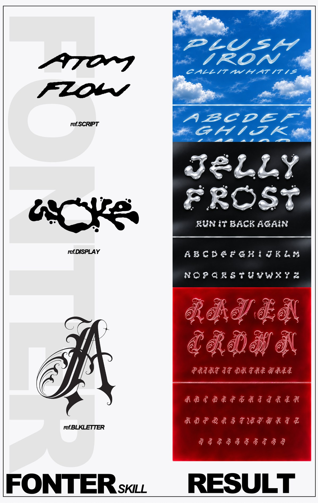

# FONTER — 设计师的福音

<p align="center"><strong>One reference image in, a real font out.</strong></p>

---

## 中文


<p align="center">一个 Codex skill，只需要一张字体参考图，一次点击，一整套直接能用的字体。<br>
One Codex skill. One font reference image. One click. A complete, ready-to-use font family.</p>

### 效果参考图

左边是参考字，右边是 FONTER 出来的结果 —— 同一套字形，换到不同材质上：



### 它做的事

| 你给 | 它还你 |
| --- | --- |
| 一张参考图（手绘草稿 / 特殊绘制的 logo 字体 / 你暂时还不想付费的字体 —— 剽窃可耻，但是你偷偷用我不会报警的） | `.otf` + `.ttf` 标准字体文件，含大小写与数字 |
| | 一张矢量撞色风格的字体预览海报（Python 生成，不消耗额度） |
| | 一张带真实材质的渲染海报（可选，不想要就不生成） |

你只需要一张参考图。参考图的平面化、拆词、切字母、矢量化、字距字高统一、封装、体检，FONTER 一套直接解决好。

### 三条规定好的设计 Guideline

- **风格不变** —— 仅按照参考图的设计风格生成，不重新设计，不改设计。
- **Token 消耗节流** —— 拆词方案经过设计，在保证效果的情况下消耗最少 token；后期用 Python 做，消耗无需担心。
- **安装包可以直接用** —— 测试已跑过 Adobe 全家桶，安装就能直接用。

### 最简单用法

**告诉你的 Codex：去 GitHub 上找一个 FONTER skill，把参考图给它，直接就可以跑。**

### 装成 Codex skill

```bash
git clone https://github.com/qianyushen/fonter ~/fontskill
ln -s ~/fontskill ~/.codex/skills/fonter
bash ~/.codex/skills/fonter/scripts/setup.sh   # 装依赖 + 自查
```

macOS 也可以直接双击 `setup.command`。依赖：Python 3.9+、`pip install -r requirements.txt`。
只有"画单词图"那一步需要模型（codex 内置 `image_gen`，或 ChatGPT 网页版），其余全部离线。

### 快速上手

```bash
python3 scripts/check_env.py                                   # 这台机器能不能直接跑
python3 scripts/segment_word.py --image 01_words/VAMPIRE/v2.png --word VAMPIRE --out 02_letters/VAMPIRE
python3 scripts/build_family.py --sources 02_letters/* --family MYFONT --out-dir 04_font --charset A-Z,0-9
python3 scripts/make_specimen.py --font 04_font/MYFONT.otf --out 05_preview/specimen.png
python3 scripts/render_material.py --project . --material "老旧红砖墙 + 街头喷漆"   # 可选：材质海报
```

海报默认把下半**排满 5 行**（26 个字 → 6 列 × 5 行，大字+数字 → 8 列 × 5 行，末行居中；`--grid-rows 2` 可回到旧版两行）。配色表共 **115 套**高饱和潘通撞色，`--palette auto` 会按字体风格散列取色并避开最近用过的 12 套，连着做几套也不会撞成同一张。

### 目录

```
SKILL.md            agent 照做的完整流程（闸门 / 词表规划 / 踩过的坑）
scripts/            切分 · 组字 · 海报 · 材质渲染 · 体检 · 环境自查
references/         生图提示词、海报与配色规范
docs/               头图 / 前后对比图
setup.command       macOS 一键装依赖
```

### 已知限制

- 生图模型偶尔会画错个别字母；**字形真值以脚本渲那张海报为准**，材质图只当氛围图。
- 装饰性极强的风格（哥特花体、重笔刷）比重几何无衬线更容易返工。
- 只在 Python 3.9 以上测过。

### 许可

MIT，见 [LICENSE](LICENSE)。

---

## English


<p align="center">One Codex skill. One font reference image. One click. A complete, ready-to-use font family.</p>

### Reference → result

Left: the reference lettering. Right: what FONTER makes of it — the same typeface, re-rendered in different materials:


### What it does

| You give | You get |
| --- | --- |
| Just one reference image. It could be a hand-drawn sketch, a custom logo typeface, or even that font you've been eyeing but aren't quite ready to pay for. Stealing is wrong, of course, but your little secret is safe with me. | Standard `.otf` + `.ttf` files, upper case + lower case + digits |
| | A bold, high-contrast vector-style font preview poster (generated entirely with Python, so no extra tokens required) |
| | A real-material render of that poster (optional — skip it if you don't want one) |

All you need is one reference image. FONTER handles everything: flattening the reference, splitting words, extracting individual letters, vectorizing, standardizing letter spacing and height, packaging the font, and running quality checks.

**One reference image. FONTER takes care of the rest.**

### Three Built-In Design Guidelines

1. **Style Fidelity** — The reference is the source of truth. FONTER follows its original design language without redesigning, altering, or "improving" the style.
2. **Token Efficiency** — The workflow is carefully designed to minimize token usage without compromising output quality. Later stages are handled by Python scripts, keeping additional token costs to a minimum.
3. **Install-Ready Fonts** — Tested across the Adobe Creative Cloud suite. Install the font and start using it right away. No extra setup required.

### The Easiest Way to Get Started

**Simply tell Codex to find the FONTER skill on GitHub, give it your reference image, and let it handle the rest.**

### Install as a Codex skill

```bash
git clone https://github.com/qianyushen/fonter ~/fontskill
ln -s ~/fontskill ~/.codex/skills/fonter
bash ~/.codex/skills/fonter/scripts/setup.sh   # deps + self-check
```

On macOS you can also double-click `setup.command`. Requirements: Python 3.9+, `pip install -r requirements.txt`.
Only the drawing step needs a model (`codex` built-in `image_gen`, or ChatGPT web); everything else runs offline.

### Quick start

```bash
python3 scripts/check_env.py                                   # is this machine ready?
python3 scripts/segment_word.py --image 01_words/VAMPIRE/v2.png --word VAMPIRE --out 02_letters/VAMPIRE
python3 scripts/build_family.py --sources 02_letters/* --family MYFONT --out-dir 04_font --charset A-Z,0-9
python3 scripts/make_specimen.py --font 04_font/MYFONT.otf --out 05_preview/specimen.png
python3 scripts/render_material.py --project . --material "old red brick + street spray paint"   # optional
```

The poster fills the lower half with **5 rows** by default (26 glyphs → 6 × 5, plus digits → 8 × 5, last row centred; `--grid-rows 2` restores the old two-row look). The palette sheet holds **115** high-contrast Pantone pairings; `--palette auto` hashes on the font's style and skips the last 12 used, so back-to-back fonts never land on the same sheet.

### Repo layout

```
SKILL.md            the playbook an agent follows (gates, word planning, pitfalls)
scripts/            segment · build · poster · material render · doctor · env check
references/         image-model prompts, poster and palette spec
docs/               hero image / reference-vs-result image
setup.command       macOS one-click dependency install
```

### Known limits

- The image model still misdraws a letter now and then; **the poster rendered from the finished font is the ground truth**, material renders are for atmosphere.
- Very illustrative styles (blackletter, heavy brush) need more retries than a geometric sans.
- Tested on Python 3.9+ only.

### License

MIT — see [LICENSE](LICENSE).

---

<p align="center"><strong>That's it. One image. One skill. A real font.</strong></p>
